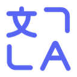

# DiscordBabel

<p align="center">
  
</p>

<p align="center">
  <strong>Real-time Discord translation</strong> for Chrome &amp; Edge<br>
  Manifest V3 · zero build step · keys stay on your device
</p>

<p align="center">
  
  
  
  
  
</p>

> **Unofficial project.** DiscordBabel is **not** affiliated with, endorsed by, or sponsored by Discord Inc. “Discord” is a trademark of Discord Inc. This repository does not represent Discord’s official products, policies, or announcements. Shared for learning and community exchange — see [DISCLAIMER.md](./DISCLAIMER.md).

---

## Why DiscordBabel

Chat across languages without leaving Discord. Incoming messages translate as you scroll; outgoing messages get a preview before you hit send. Free engines work out of the box—bring your own DeepL or AI key when you want higher quality.

## Features

- **Inbound** — auto-translate messages in view; click to show original or force-translate
- **Understood languages** — keep selected languages as-is
- **Outbound preview** — Enter opens a send/keep dialog (follows light/dark theme)
- **Styles** — code-block, soft, accent, contrast, minimal; color & font options
- **Free engines** — Google + MyMemory, or Edge + Volcengine
- **DeepL & AI** — your keys, OpenAI-compatible APIs
- **Hotkeys** — `Alt+T` toggle · `Alt+O` outbound (`⌃⌥` on Mac)

## AI providers

Pick a provider in the popup, then paste a key (or authorize TokenDance):

| Provider | Base URL |
|----------|----------|
| **TokenDance** | `https://tokendance.space/gateway/v1` |
| Kimi | `https://api.moonshot.cn/v1` |
| Kimi International | `https://api.moonshot.ai/v1` |
| Zhipu GLM | `https://open.bigmodel.cn/api/paas/v4` |
| Zhipu GLM International | `https://api.z.ai/api/paas/v4` |
| MiniMax | `https://api.minimax.cn/v1` |
| MiniMax International | `https://api.minimax.io/v1` |
| StepFun | `https://api.stepfun.com/v1` |
| DeepSeek · Qwen · OpenAI · Anthropic · Gemini · OpenRouter · Ollama | listed in the extension |

TokenDance supports [OAuth-style API key grant](https://tokendance.space/docs/api-key-oauth) (PKCE) plus live model refresh. Custom base URL and model ID are always available.

## Install

1. Open `chrome://extensions` (or Edge’s Extensions page)
2. Enable **Developer mode** → **Load unpacked**
3. Select this repository folder
4. Open Discord and **reload** the tab

After an update, reload Discord once if translations look stale.

## Privacy

No telemetry. No backend of ours. Requests go from the extension service worker straight to the provider you chose. API keys live in `chrome.storage.local`, scoped by origin.

## Develop

Static MV3—edit files, then hit **Reload** on the extension card.

```bash
node tools/gen-i18n.mjs   # regenerate UI locale packs
```

## Disclaimer

Not an official Discord product. Not affiliated with Discord Inc. Full text: [DISCLAIMER.md](./DISCLAIMER.md).

## License

[MIT](./LICENSE) © DiscordBabel
